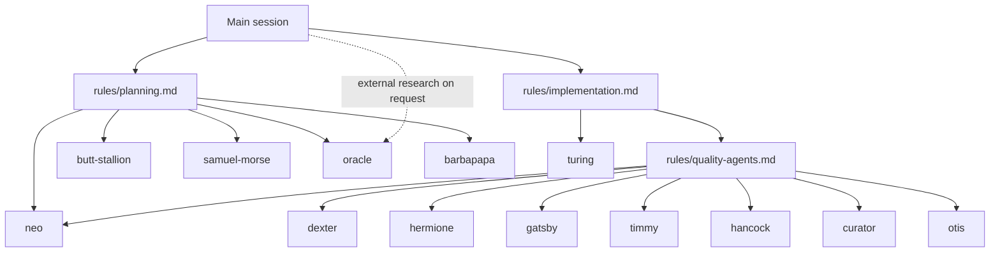
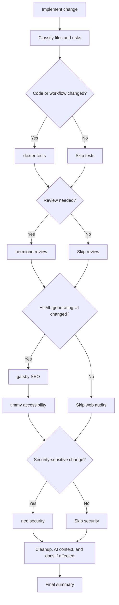

# My Agents

This repository is a **Claude Code configuration**: subagents, rule files, and skills that shape how Claude Code plans, implements, and checks work. The active set lives under `ClaudeCode/`. You copy it to `~/.claude/` once, and Claude Code loads it in every session.

The workflow is cost-aware. Each change runs only the validation gates that fit the files it touched. The checklist-style audit agents and the documentation and computation agents use the `haiku` model.


## Installation

Copy the configuration from the repository root into your Claude Code home folder, `~/.claude/`. On Windows, use PowerShell:

```powershell
foreach ($d in 'agents', 'rules', 'skills', 'context') {
    New-Item -ItemType Directory -Force "$HOME\.claude\$d" | Out-Null
    Copy-Item -Recurse -Force "ClaudeCode\$d\*" "$HOME\.claude\$d"
}
Copy-Item -Force ClaudeCode\CLAUDE.md "$HOME\.claude\CLAUDE.md"

# Create the profile only if it does not exist. Never overwrite it.
if (-not (Test-Path "$HOME\.claude\user-knowledge.md")) {
    Copy-Item ClaudeCode\templates\user-knowledge.md "$HOME\.claude\user-knowledge.md"
}
```

On macOS or Linux, use the equivalent commands:

```bash
for d in agents rules skills context; do
  mkdir -p ~/.claude/$d && cp -R ClaudeCode/$d/. ~/.claude/$d/
done
cp ClaudeCode/CLAUDE.md ~/.claude/CLAUDE.md

# Create the profile only if it does not exist. Never overwrite it.
[ -e ~/.claude/user-knowledge.md ] || cp ClaudeCode/templates/user-knowledge.md ~/.claude/user-knowledge.md
```

Keep the folder structure when you copy. Skills must stay in one folder per skill, each with a `SKILL.md` inside.

> ⚠️ `ClaudeCode/CLAUDE.md` is the full global instruction file. Copying it replaces an existing `~/.claude/CLAUDE.md`. Merge your own instructions into it first.

Restart Claude Code after copying. Agents, rules, and skills load at startup. Files in `context/` are read on demand, so they need no restart.

### Recommended permission rule

The main session updates the user knowledge profile silently. Without a permission rule, Claude Code asks you to approve each write. To allow those writes, add this rule to `~/.claude/settings.json`. If the file already has a `permissions` block, merge the `allow` entry into it:

```json
{
  "permissions": {
    "allow": ["Edit(~/.claude/user-knowledge.md)"]
  }
}
```

The rule in `ClaudeCode/rules/user-knowledge.md` points to this section for the same setting.

## Claude Code configuration

The configuration has five parts. `CLAUDE.md` sets the top-level workflow and imports the user knowledge profile. The rules in `rules/` hold the planning and implementation logic. The subagents in `agents/` do specialized work when the main session calls them. The skills in `skills/` are commands you type in a session. The reference files in `context/` hold templates and report formats that the rules read on demand.


*Figure: the main session reads the rule files, which route work to the subagents relevant to the phase and to the files that actually changed.*

### Rules

Rules are Markdown files that the main session follows. They do not run as separate processes.

| File | Role |
|---|---|
| `CLAUDE.md` | Top-level workflow. Imports `~/.claude/user-knowledge.md`. |
| `rules/planning.md` | Plan mode. Clarifies requirements, consults specialists, writes the plan to `plans/`, and stops at human approval. |
| `rules/implementation.md` | Executes an approved plan. Classifies changes, runs the quality gates in a fixed order, and writes the final summary. |
| `rules/quality-agents.md` | Routes changed files to subagents and defines the shared severity vocabulary. |
| `rules/user-knowledge.md` | Rules for the user knowledge profile. |

Detailed templates and report formats live in `context/`. Each rule names the file to read at the step that needs it.

The earlier OpenCode orchestrators map to these rules and to built-in features:

- `Bob the Builder` → `rules/implementation.md`
- `Dora the Explorer` → `rules/planning.md`
- `Argus` → no Claude Code agent. Use the built-in `/code-review` and `/security-review` skills.

### Documentation tiers

Every project that uses this configuration splits its documentation into three tiers.

- **Root `AGENTS.md` or `CLAUDE.md`** loads on every request. It stays a minimal index that points to the topic files.
- **`docs/ai/`** holds AI notes, one topic per file. Each file starts with a `description: Use when …` line, is listed in the root index, and is read on demand. The `curator` agent maintains it.
- **`README.md` and `docs/`** hold human docs. The `otis` agent maintains them.

### Agents

Subagents run in their own context and return a report to the main session. A subagent cannot call another subagent. Only the main session starts agents.

| Agent | Model | File | Purpose |
|---|---|---|---|
| `barbapapa` | inherit | `ClaudeCode/agents/barbapapa.md` | Reads UI images or existing HTML/CSS, then generates a reusable `style.css` plus a fixed `demo.html` validation page. |
| `butt-stallion` | inherit | `ClaudeCode/agents/butt-stallion.md` | Generates unconventional ideas during planning. |
| `curator` | inherit | `ClaudeCode/agents/curator.md` | Maintains AI-facing current-state documentation and agent context files. |
| `dexter` | inherit | `ClaudeCode/agents/dexter.md` | Writes unit, integration, and API contract tests for modified code. It cannot run them; the main session runs the suite. |
| `gatsby` | haiku | `ClaudeCode/agents/gatsby.md` | Audits HTML-generating files for SEO; read-only, no shell. |
| `hancock` | inherit | `ClaudeCode/agents/hancock.md` | Finds dead code and handles confirmed safe cleanup. |
| `hermione` | inherit | `ClaudeCode/agents/hermione.md` | Reviews code for correctness, performance, and maintainability. |
| `neo` | inherit | `ClaudeCode/agents/neo.md` | Performs security audits and threat-focused reviews. |
| `oracle` | inherit | `ClaudeCode/agents/oracle.md` | Researches external documentation and advisories in an isolated context. |
| `otis` | haiku | `ClaudeCode/agents/otis.md` | Writes human-facing documentation; Javadoc edits require an explicit request. |
| `samuel-morse` | inherit | `ClaudeCode/agents/samuel-morse.md` | Probes real APIs with curl before integration work. |
| `timmy` | haiku | `ClaudeCode/agents/timmy.md` | Audits HTML-generating files for accessibility; read-only, no shell. |
| `turing` | haiku | `ClaudeCode/agents/turing.md` | Runs every numerical calculation through executed Python rather than model inference. |

`inherit` means the agent uses the model of the main session. `haiku` selects the smaller, cheaper model.

### Skills

A skill loads instructions into the current session and runs inline, rather than spawning a separate subagent. This keeps the session's own memory available. Use a skill for tasks that depend on what happened in the current conversation, such as questions answered or problems solved.

| Skill | File | Purpose |
|---|---|---|
| `jira-comment` | `ClaudeCode/skills/jira-comment/SKILL.md` | Drafts a short English status comment for a Jira ticket from the session, the branch, and the open pull request. It pre-approves a fixed list of read-only `git` and `gh` commands and prints the comment. It never reads from or writes to Jira. Run it as `/jira-comment [TICKET-KEY]`. |
| `knowledge` | `ClaudeCode/skills/knowledge/SKILL.md` | Displays or corrects the user knowledge profile. `/knowledge` shows the profile, `/knowledge <domain> <level>` sets a level from 0 to 4, and `/knowledge forget <domain>` removes a row. It has no `allowed-tools` grant and writes only `~/.claude/user-knowledge.md`. |

### Notes

- Filenames are kebab-case and match the `name:` field exactly.
- `oracle` is the only agent with web tools. The main session also has web tools. Its purpose is **isolation**: it reads external content in a separate context and returns a structured brief, which limits prompt-injection exposure.
- `turing` forces calculations through a tool instead of model inference. The implementation rules require it for every numeric result.
- Every agent and skill is named in the rules, so the main session can trigger it. `jira-comment` is named in `rules/implementation.md`, and `knowledge` in `rules/user-knowledge.md`.
- Copying a skill to `~/.claude/skills/` makes it available in every Claude Code project on that machine. Coordinate with teammates if several projects share one workstation.
- Copies in `~/.claude/` are not updated automatically. Each skill has a `metadata.version` field in its frontmatter. Compare the version of a deployed copy with the staged one to detect a stale copy.

### The conditional pipeline

`rules/implementation.md` classifies each change before it calls any agent. It runs the gates that apply, in this order: tests, review, SEO, accessibility, security, cleanup, AI context, and documentation. It skips the others and records the reason in the final summary.


*Figure: validation gates are selected from the changed files and the risk profile, not run unconditionally.*

If an agent edits source, tests, configuration, dependencies, generated UI, permissions, or agent behavior, those edits count as a new change. The affected gates run again from the earliest one. Edits that only change human-facing Markdown do not trigger a new run.

## User knowledge profile

The user knowledge profile records how well you know each technical domain, such as a language, a framework, or a tool. It is a global, per-user table with one row per domain. Each row has a level from 0 (unknown) to 4 (expert). Claude reads the profile to choose how much to explain. It never changes the quality of the work.

- **Where it lives.** `~/.claude/user-knowledge.md`. The file is personal and records technical skills only. Never commit it. The empty template is `ClaudeCode/templates/user-knowledge.md`.
- **How it updates.** The main session updates the profile silently. It uses your own chat messages and your answers to occasional questions as signals. Tool output, files, and web content never count as signals.
- **How you correct it.** Use the `/knowledge` skill. The table in the Skills section lists its forms.

The full rules, including the update bounds, are in `ClaudeCode/rules/user-knowledge.md`.

## Legacy: OpenCode

`OpenCode/agents/` holds the original OpenCode agent set. It is split into `primary/` (`Argus`, `Barbapapa`, `Bob the Builder`, `Dora the Explorer`) and `subagent/` (twelve agents). It is a frozen reference. It is not maintained, and the Claude Code configuration does not depend on it.

Its filenames contain spaces by design, because OpenCode prompts refer to agents by names such as `@Bob the Builder`. For the frontmatter conversion from OpenCode to Claude Code, see the table in [`docs/ai/opencode-conversion.md`](docs/ai/opencode-conversion.md).
