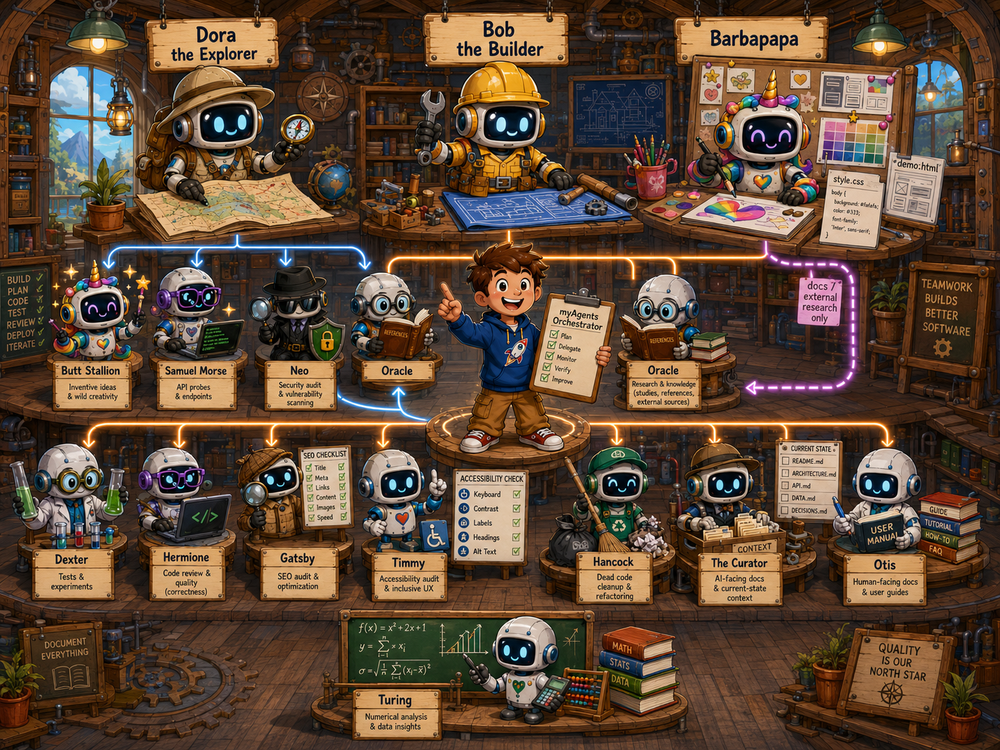
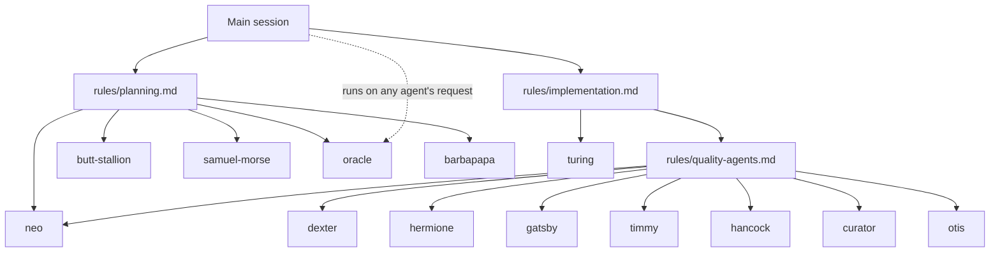
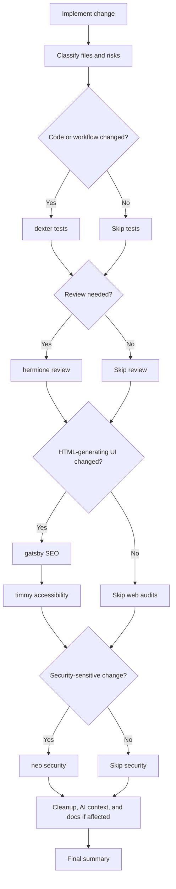

# My Agents

This repository contains two agent sets for agentic coding, plus reusable skills: the original **OpenCode** definitions under `OpenCode/`, and their **Claude Code** port under `ClaudeCode/` with skills under `ClaudeCode/skills/`. Both use a cost-aware workflow in which only the validation gates relevant to the changed files are run, and the checklist-style audit agents use a cheaper model.

## Claude Code

Claude Code has no notion of a "primary" agent — every file in `agents/` is a subagent invoked from the main session. The OpenCode orchestrators therefore had nowhere to live as agents, so their logic moved into rule files that the main session follows:

- `Bob the Builder` → `ClaudeCode/rules/implementation.md`
- `Dora the Explorer` → `ClaudeCode/rules/planning.md`
- `Argus` → dropped, superseded by the built-in `/code-review` and `/security-review` skills

*Figure: the main session reads the rule files, which route work to the subagents relevant to the phase and to the files that actually changed.*

### Agents

| Agent | Model | File | Purpose |
|---|---|---|---|
| `barbapapa` | inherit | `ClaudeCode/agents/barbapapa.md` | Reads UI images or existing HTML/CSS, then generates a reusable `style.css` plus a fixed `demo.html` validation page. |
| `butt-stallion` | inherit | `ClaudeCode/agents/butt-stallion.md` | Generates unconventional ideas during planning. |
| `curator` | inherit | `ClaudeCode/agents/curator.md` | Maintains AI-facing current-state documentation and agent context files. |
| `dexter` | inherit | `ClaudeCode/agents/dexter.md` | Writes unit, integration, and API contract tests for modified code. |
| `gatsby` | haiku | `ClaudeCode/agents/gatsby.md` | Audits HTML-generating files for SEO; read-only, no shell. |
| `hancock` | inherit | `ClaudeCode/agents/hancock.md` | Finds dead code and handles confirmed safe cleanup. |
| `hermione` | inherit | `ClaudeCode/agents/hermione.md` | Reviews code for correctness, performance, and maintainability. |
| `neo` | inherit | `ClaudeCode/agents/neo.md` | Performs security audits and threat-focused reviews. |
| `oracle` | inherit | `ClaudeCode/agents/oracle.md` | Researches external documentation and advisories in an isolated context. |
| `otis` | haiku | `ClaudeCode/agents/otis.md` | Writes human-facing documentation; Javadoc edits require an explicit request. |
| `samuel-morse` | inherit | `ClaudeCode/agents/samuel-morse.md` | Probes real APIs with curl before integration work. |
| `timmy` | haiku | `ClaudeCode/agents/timmy.md` | Audits HTML-generating files for accessibility; read-only, no shell. |
| `turing` | haiku | `ClaudeCode/agents/turing.md` | Runs every numerical calculation through executed Python rather than model inference. |

### Skills

A skill loads instructions into the current session and runs inline, rather than spawning a separate subagent. This makes it suitable for tasks that depend on the session's own memory — questions answered, challenges overcome, decisions made during the current work — which would be lost in a fresh subagent context.

| Skill | File | Purpose |
|---|---|---|
| `jira-comment` | `ClaudeCode/skills/jira-comment/SKILL.md` | Drafts a status comment for a completed Jira ticket, capturing what was built, the challenges overcome, and anything deferred. Runs inline in the current session, preserving context that only this conversation remembers. |

### Notes

- Filenames are kebab-case and match the `name:` field exactly.
- No subagent can call another subagent; only the main session spawns agents. When an agent needs external research it says so in its report, and the session runs `oracle`.
- `oracle` is the only agent with web tools. Since the main session also has `WebSearch` and `WebFetch`, its value is no longer exclusive access but **isolation**: external content is read in a separate context and returned as a structured brief, which limits prompt-injection exposure.
- `turing` exists to force computation through a tool instead of through model inference. Under OpenCode it was an orphan — listed but never called — and it is now referenced from `rules/implementation.md`.
- Every agent and skill must be referenced in the workflow: an unreferenced agent cannot trigger at all, whereas an unreferenced skill remains typeable but unknown and becomes dead weight. `jira-comment` is referenced in `ClaudeCode/rules/implementation.md`.
- `ClaudeCode/agents/`, `ClaudeCode/rules/`, and `ClaudeCode/skills/` are staged here and must be copied to `~/.claude/` to take effect (skills are folders; preserve the folder structure when copying). Restart Claude Code after copying.
- Copying a skill to `~/.claude/skills/` makes it available in every Claude Code project on that machine, not just this one — coordinate with teammates if multiple projects share the same workstation.
- There is no automatic update mechanism: a skill copied to `~/.claude/` will remain there even after the staged version changes. Each skill carries a `metadata.version` field in its frontmatter so you can compare a deployed copy against the staged one to detect staleness.

### The conditional pipeline

`rules/implementation.md` classifies each change before calling any agent, skips the gates that do not apply, and records the skip reason in the final summary.

*Figure: validation gates are selected from the changed files and the risk profile, not run unconditionally.*

If an agent edits source, tests, configuration, dependencies, generated UI, permissions, or agent behavior, those edits count as a new delta and the affected gates re-run. Human-facing Markdown-only updates do not trigger that loop.

## OpenCode

The OpenCode set remains functional and unchanged under `OpenCode/agents/`, split into `primary/` (`Argus`, `Barbapapa`, `Bob the Builder`, `Dora the Explorer`) and `subagent/` (the other twelve). Its filenames intentionally include spaces because OpenCode prompts reference names like `@Bob the Builder` and `@Samuel Morse`.

See `AGENTS.md` for repository maintenance instructions and the full frontmatter conversion table.
